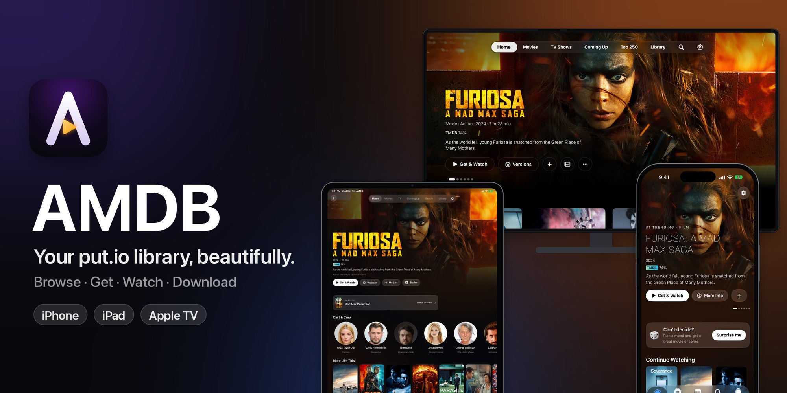
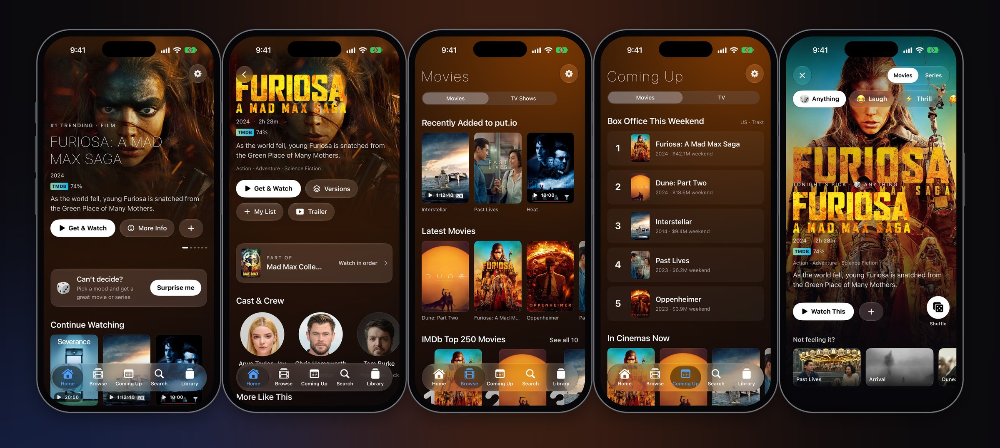
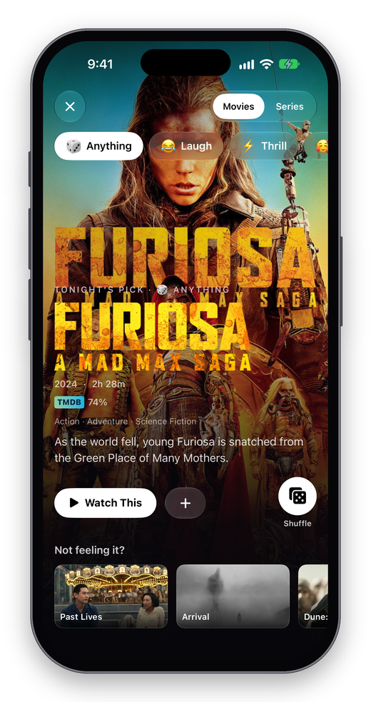
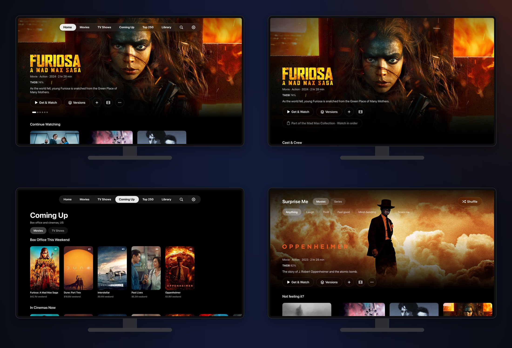
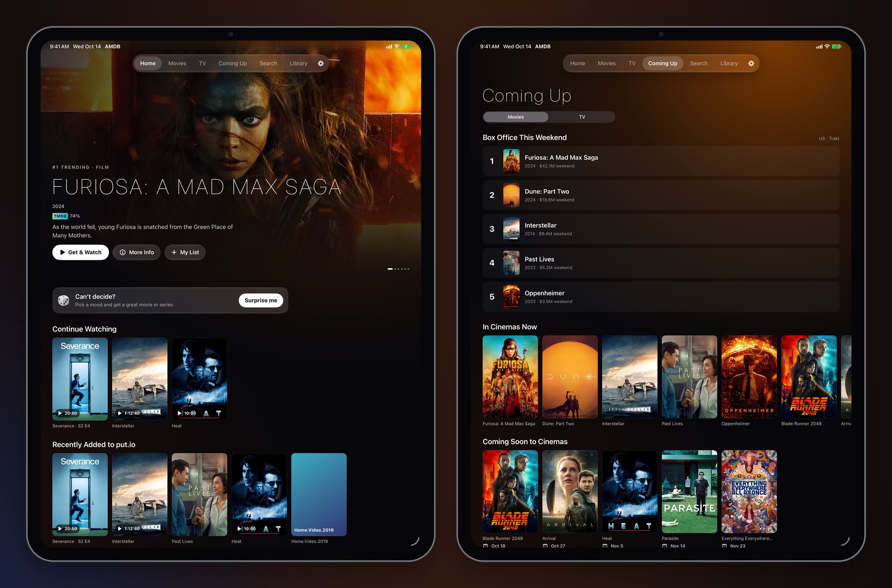

<div align="center">



<br>


**A native put.io client for iPhone, iPad and Apple TV.**<br>
Browse every movie and show, send the best release to put.io in one tap,<br>
and watch with your progress, subtitles and downloads everywhere.

[Features](docs/FEATURES.md) · [Architecture](docs/ARCHITECTURE.md) · [Development](docs/DEVELOPMENT.md)

</div>

<br>



## Why AMDB

put.io is a great place to keep movies and shows. AMDB makes it feel like a streaming service: your library matched
to rich artwork and ratings, smart discovery, one-tap "Get & Watch", a real player, and every Apple-platform nicety,
on the phone in your pocket and the TV in your living room.

<table>
  <tr>
    <td width="33%" valign="top" align="center">
      
      <h3>Your library, front and center</h3>
      Continue Watching, Recently Added and My List, from a put.io library matched to TMDB and cached so the app opens
      instantly.
    </td>
    <td width="33%" valign="top" align="center">
      
      <h3>Every title, in depth</h3>
      Logo art, cast, collections, trailers, and ratings from IMDb, Rotten Tomatoes, Metacritic, Letterboxd and TMDB;
      IMDb ratings for every episode.
    </td>
    <td width="33%" valign="top" align="center">
      
      <h3>Endless discovery</h3>
      New on Netflix and Disney+, New Series, Returning This Week, Critically Acclaimed, IMDb Top 250, and the latest
      releases from chill and MyMoviz.
    </td>
  </tr>
  <tr>
    <td width="33%" valign="top" align="center">
      
      <h3>Coming Up</h3>
      This weekend's box office, what's in cinemas, and the next episodes of your shows, day by day.
    </td>
    <td width="33%" valign="top" align="center">
      
      <h3>Surprise Me</h3>
      Pick a mood and get a great movie or series, with alternatives and Shuffle. Also in Control Center.
    </td>
    <td width="33%" valign="top">
      <h3>Get &amp; Watch</h3>
      <ul>
        <li>Best release by your rules: quality, size, seeders</li>
        <li>Sent to put.io, tracked with a Live Activity</li>
        <li>Plays the moment it's ready</li>
        <li>Or pick any version yourself</li>
      </ul>
      <h3>A real player</h3>
      <ul>
        <li>Resume synced across devices</li>
        <li>put.io + OpenSubtitles, timing, styles</li>
        <li>Picture in Picture, AirPlay</li>
        <li>Next episode, sleep timer</li>
        <li>Swipe down to close</li>
      </ul>
      <h3>Offline</h3>
      <ul>
        <li>Download movies, episodes or whole seasons, subtitles included</li>
      </ul>
    </td>
  </tr>
</table>

## Built for Apple TV



A full-screen, focus-driven design: black canvas, full-bleed art, glass buttons that turn white when selected.
Every feature that makes sense on a TV is there, plus **Top Shelf**, **sign-in with a code**, a Netflix-style
**search keyboard**, and settings shared with your iPhone through iCloud Keychain.

## And on iPad



## Deeply integrated

| | |
|---|---|
| **Ask AMDB** | "a twisty 90s thriller under 2 hours": Apple Intelligence turns a sentence into a search (iOS 26) |
| **Siri** | "Play *Severance* in AMDB", "What's coming up in AMDB", "Get a movie with AMDB" |
| **Spotlight** | Your put.io and My List titles in system search |
| **Control Center** | A Surprise Me button for Control Center, the Lock Screen and the Action button |
| **Widgets & Live Activities** | Continue Watching on the Home Screen; transfer progress in the Dynamic Island |
| **Top Shelf** | Continue Watching and Recently Added on the Apple TV Home Screen |
| **Liquid Glass** | Floating glass tab bar and controls, in the style of Apple's TV app |

## Get started

```bash
git clone https://github.com/AmirhosseinKhanlari/AMDB--Amir-Movie-Database.git
cd AMDB--Amir-Movie-Database
brew install xcodegen
cp Config/Secrets.example.xcconfig Config/Secrets.xcconfig   # add your TMDB token (and optional keys)
xcodegen generate && open AMDB.xcodeproj
```

Pick **AMDB** (iPhone/iPad) or **AMDBTV** (Apple TV), choose a simulator and press **⌘R**.<br>
No accounts yet? Add the launch argument **`-demo`** for built-in sample content: everything in these screenshots.

| Key in `Config/Secrets.xcconfig` | For | Get it from |
|---|---|---|
| `TMDB_READ_TOKEN` | Required: catalog, artwork, matching | themoviedb.org → Settings → API |
| `TRAKT_CLIENT_ID` | IMDb Top 250, box office | trakt.tv/oauth/applications |
| `OPENSUBTITLES_API_KEY` | Optional built-in subtitle search | opensubtitles.com → API consumers |

The secrets file is gitignored. Users sign in to put.io in the app; chill, MDBList and OpenSubtitles accounts are
optional and live in Settings.

## Under the hood

- **Swift 6 with strict concurrency**, SwiftUI and Observation across three app targets and three extensions.
- **One shared Swift package**: `AMDBCore` (put.io, TMDB, Trakt, ratings and subtitle clients; release sources;
  parsers) and `AMDBKit` (app state and view models), covered by 260+ Swift Testing tests.
- AVKit and AVFoundation (HLS streaming and offline downloads), ActivityKit, WidgetKit, App Intents, Core Spotlight,
  Foundation Models, TVServices.
- Project generated by **XcodeGen** from a single `project.yml`.

<details>
<summary><b>Project layout</b></summary>

```
AMDBCore/            Swift package
  Sources/AMDBCore/    API clients, release sources, parsers
  Sources/AMDBKit/     App state and view models shared by every platform
  Tests/               Swift Testing suites
App/
  iOS/                 iPhone and iPad app
  tvOS/                Apple TV app
  SharedUI/            Views and helpers shared by both apps
  Shared/              Code shared by the iOS app and its extensions
  Widgets/             Widgets, Live Activity, Control Center control
  TopShelf/, TVShared/ Apple TV Top Shelf
  UITests/, TVUITests/ UI tests
Config/              Build settings and the secrets template
docs/                Documentation and images
project.yml          XcodeGen spec
```
</details>

## Documentation

| | |
|---|---|
| [**Features**](docs/FEATURES.md) | The complete tour, by platform |
| [**Architecture**](docs/ARCHITECTURE.md) | Modules, data flow, caching, background work |
| [**Development**](docs/DEVELOPMENT.md) | Setup, demo mode, testing, TestFlight, troubleshooting |

## Disclaimer

AMDB is a personal project, not affiliated with put.io, chill.institute, TMDB, IMDb, Trakt, OpenSubtitles or any release
source. You are responsible for what you download; follow the laws where you live and the terms of the services you
connect.

<sub>

&nbsp;This product uses the TMDB API but is not endorsed or certified by TMDB. Artwork in the screenshots comes from TMDB.
</sub>
