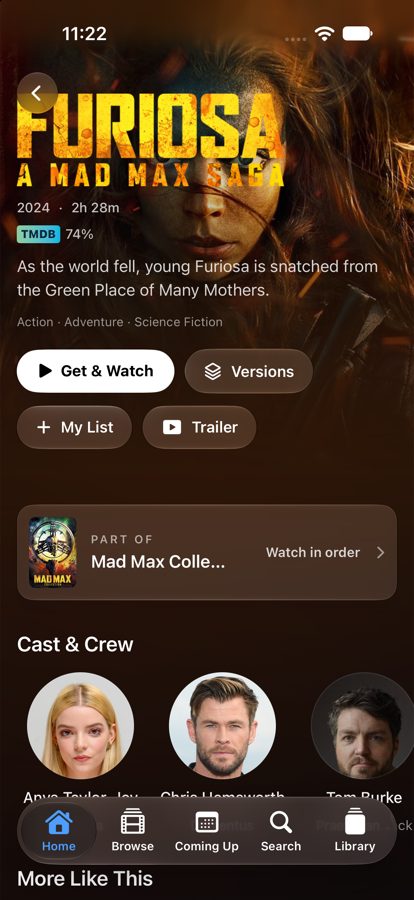
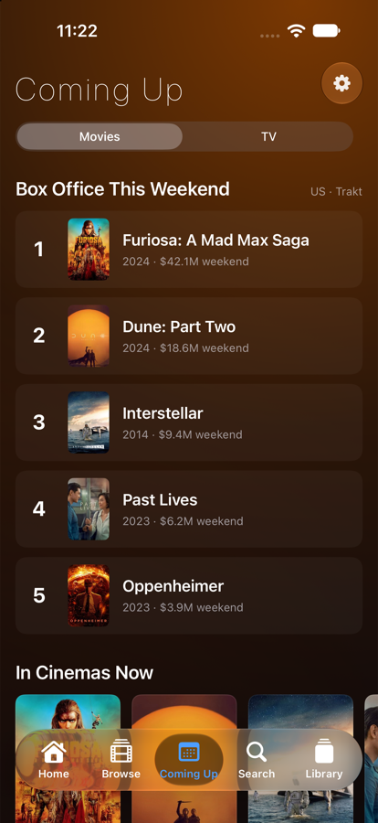

# AMDB

**A native put.io client for iPhone, iPad and Apple TV.** Browse movies and shows with TMDB, find releases, send them to
put.io, and watch with your progress, subtitles and downloads in one place.

Built entirely in Swift 6 and SwiftUI, with a shared Swift package for all the logic and separate, platform-native
interfaces for iOS/iPadOS and tvOS.

<p>
  
  
  
</p>
<p>
  
</p>

## Highlights

- **Your put.io library, matched to TMDB**: posters, Continue Watching, Recently Added, episodes grouped by season, all
  cached so the app opens instantly.
- **Discover**: trending slider, Popular, Top Rated, genres, New on Netflix / Disney+, New Series, Returning This Week,
  Critically Acclaimed, IMDb Top 250, Latest Movies / Shows, Surprise Me, people and collections.
- **Coming Up**: weekend box office, what's in cinemas, and the next episodes of your shows, by day.
- **Get & Watch**: picks the best release by your rules (quality, size, seeders), sends it to put.io, tracks the transfer
  with a Live Activity, and plays it when it's ready. Or pick any version yourself.
- **A real player**: custom controls on iPhone/iPad, Apple's player on TV, Picture in Picture, AirPlay, next-episode
  auto-play, sleep timer, resume synced to put.io.
- **Subtitles**: put.io's tracks plus OpenSubtitles search, timing adjustment, and your own style.
- **Offline downloads** on iPhone and iPad, with subtitles saved alongside.
- **Ratings** from IMDb, Rotten Tomatoes, Metacritic, Letterboxd and TMDB, plus IMDb ratings per episode.
- **Apple features**: Siri and Spotlight, a Control Center button, widgets, Live Activities, Apple TV Top Shelf, and Ask
  AMDB (natural-language search with Apple Intelligence).

See **[Features](docs/FEATURES.md)** for the full tour.

## Requirements

| | |
|---|---|
| Devices | iPhone and iPad on iOS 17+, Apple TV on tvOS 17+ (some features need iOS 18 / 26, noted in Features) |
| To build | macOS with Xcode 26 or later, [XcodeGen](https://github.com/yonaskolb/XcodeGen) |
| Accounts | A [put.io](https://put.io) account. Optional: [chill.institute](https://chill.institute), [MDBList](https://mdblist.com) for ratings, [OpenSubtitles](https://www.opensubtitles.com) |
| API keys | A TMDB read access token; optional Trakt client ID and OpenSubtitles API key |

## Quick start

```bash
git clone https://github.com/AmirhosseinKhanlari/AMDB--Amir-Movie-Database.git
cd AMDB--Amir-Movie-Database
brew install xcodegen
cp Config/Secrets.example.xcconfig Config/Secrets.xcconfig   # then fill in your keys
xcodegen generate
open AMDB.xcodeproj
```

Choose the **AMDB** scheme for iPhone/iPad or **AMDBTV** for Apple TV, pick a simulator and press **⌘R**.

No accounts handy? Add the launch argument **`-demo`** (Product → Scheme → Edit Scheme → Arguments) to run with built-in
sample content.

Full setup, testing and release steps are in **[Development](docs/DEVELOPMENT.md)**.

## Configuration

Keys live in `Config/Secrets.xcconfig`, which is **gitignored** and never committed:

| Key | Needed for | Where to get it |
|---|---|---|
| `TMDB_READ_TOKEN` | Everything (catalog, artwork, matching) | themoviedb.org → Settings → API → *API Read Access Token* |
| `TRAKT_CLIENT_ID` | IMDb Top 250 and the box office chart | trakt.tv/oauth/applications → New Application |
| `OPENSUBTITLES_API_KEY` | Built-in OpenSubtitles search (optional; users can add their own) | opensubtitles.com → API consumers |

Users sign in to put.io inside the app (OAuth on iPhone, a code on Apple TV). chill, MDBList and OpenSubtitles accounts
are optional and added in Settings. Credentials are stored in the Keychain and shared between iPhone and Apple TV
through iCloud Keychain.

## Project layout

```
AMDBCore/            Swift package
  Sources/AMDBCore/    API clients (put.io, TMDB, Trakt, OpenSubtitles, ratings), release sources, parsers
  Sources/AMDBKit/     App state and view models shared by every platform
  Tests/               Swift Testing suites for both modules
App/
  iOS/                 iPhone and iPad app (SwiftUI)
  tvOS/                Apple TV app (SwiftUI)
  SharedUI/            Views and helpers used by both apps (artwork, theme, demo mode)
  Shared/              Code shared by the iOS app and its extensions
  Widgets/             Widgets, Live Activity, Control Center control
  TopShelf/, TVShared/ Apple TV Top Shelf extension
  UITests/, TVUITests/ UI tests
Config/              Build settings and the secrets template
docs/                Documentation
project.yml          XcodeGen spec (the Xcode project is generated, not committed)
```

How it fits together is in **[Architecture](docs/ARCHITECTURE.md)**.

## Documentation

- [Features](docs/FEATURES.md): everything the apps can do, by platform
- [Architecture](docs/ARCHITECTURE.md): modules, data flow, caching, background work
- [Development](docs/DEVELOPMENT.md): setup, demo mode, testing, TestFlight releases, troubleshooting

## Disclaimer

AMDB is a personal project. It is not affiliated with put.io, chill.institute, TMDB, IMDb, Trakt, OpenSubtitles or any
release source. You are responsible for what you download and must follow the laws where you live and the terms of the
services you connect.


This product uses the TMDB API but is not endorsed or certified by TMDB.
