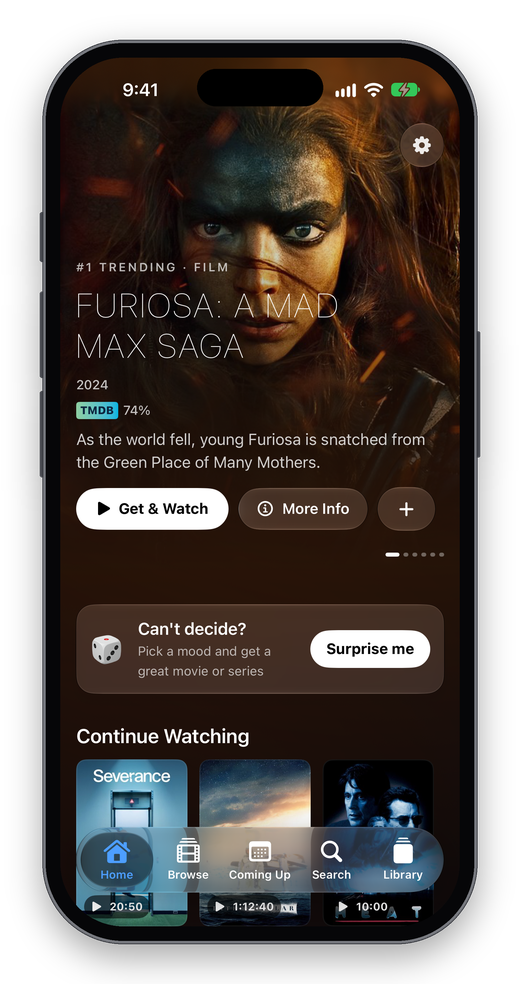
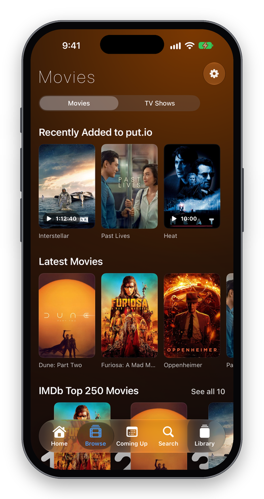
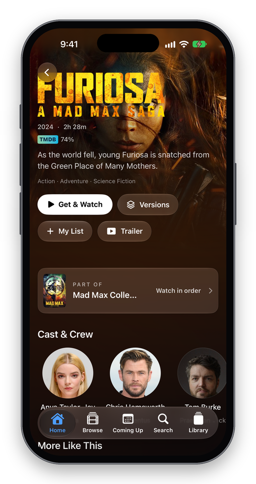
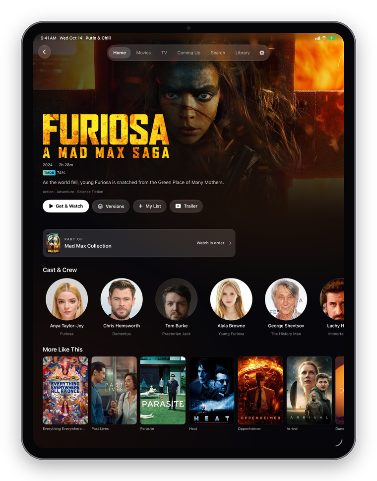
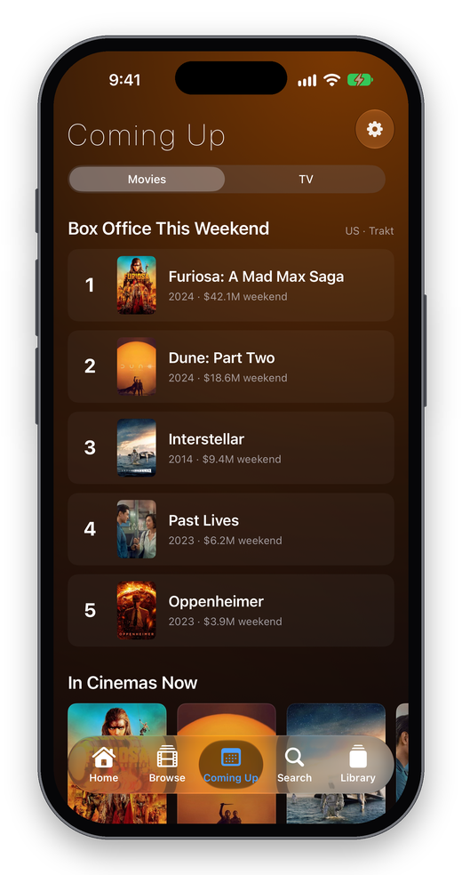
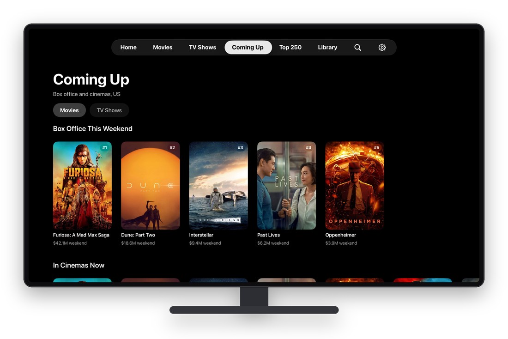
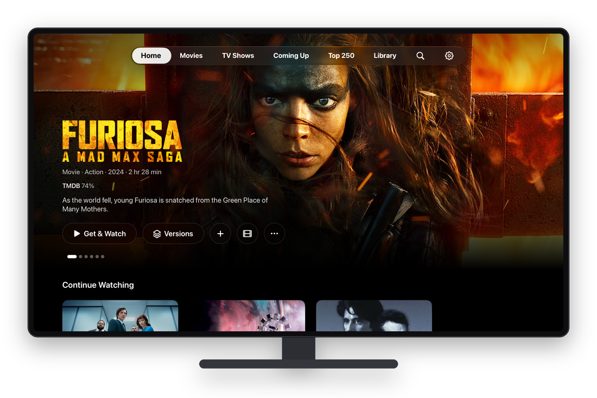
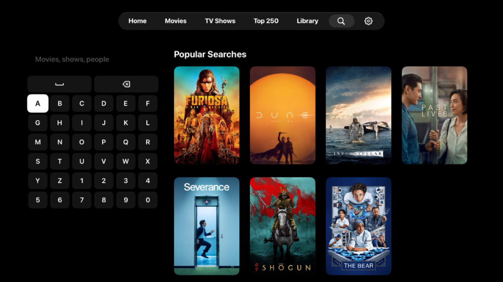
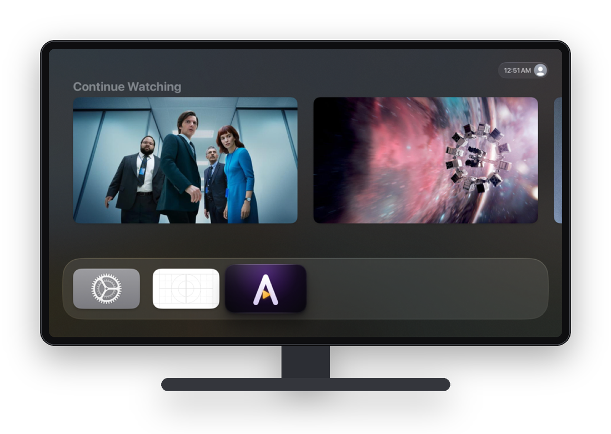
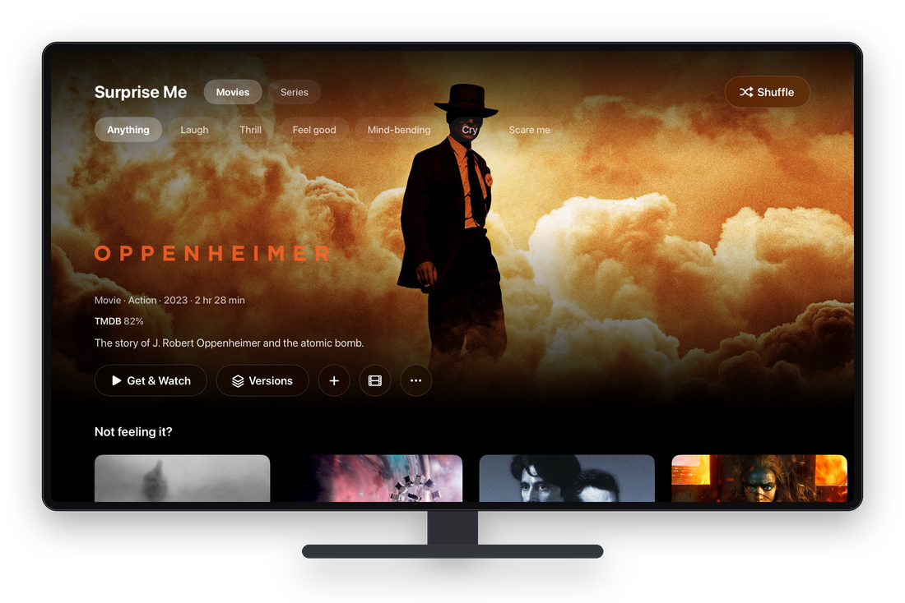

# Features

Everything Putio & Chill does, by area. Unless noted, a feature works on iPhone, iPad and Apple TV.

- [Getting started](#getting-started)
- [Home and browsing](#home-and-browsing)
- [Titles, people and collections](#titles-people-and-collections)
- [Coming Up](#coming-up)
- [Search and Ask Chill](#search-and-ask-chill)
- [Getting releases](#getting-releases)
- [Library](#library)
- [Playback](#playback)
- [Subtitles](#subtitles)
- [Offline downloads](#offline-downloads-iphone-and-ipad)
- [Ratings](#ratings)
- [System integration](#system-integration)
- [Apple TV](#apple-tv)
- [Settings](#settings)

## Getting started

- **put.io sign-in**: OAuth in the browser on iPhone/iPad. On Apple TV, a short code to enter at put.io/link (or a QR
  code to scan), so you never type a password with the remote.
- **Optional accounts**: MDBList (ratings), OpenSubtitles (more subtitle downloads).
- **iCloud Keychain**: keys and accounts added on iPhone appear on Apple TV by themselves.
- **Demo mode**: launch with `-demo` to explore with sample content, no accounts needed.

## Home and browsing

 

- **Featured slider**: six trending titles with logo art, ratings and actions; advances on its own and pauses while you
  interact.
- **Continue Watching**: one card per movie or show, at the episode you're on, with time left.
- **Surprise Me**: pick Movies or Series and a mood (Laugh, Thrill, Feel good, Mind-bending, Cry, Scare me); get a
  well-rated pick (TMDB 6.5+, 500+ votes) with alternatives and Shuffle.
- **My List**: save anything with ＋; See All page.
- **Recently Added to put.io**, on Home and per kind on Movies and TV Shows.
- **Movies / TV Shows** (on iPhone, both under **Browse** with a switch):
  - Recently Added to put.io, then **New to Stream** (movies with a digital or disc release in your region in the last
    45 days, from TMDB) or **New Episodes This Week** (shows with an episode out in the last seven days), then
    **Latest Movies / Latest Shows** (MyMoviz's newest, refreshed every time the app opens).
  - **IMDb Top 250**.
  - **New on Netflix**, **New on Disney+** (US catalogs), **New Series**, **Returning This Week**, **Critically
    Acclaimed**.
  - Popular, Top Rated, and genre rows.
- **First launch**: a "Matching N titles…" row while put.io is read, never raw file names.

## Titles, people and collections

 

- **Title page**: full-bleed art and logo, year, runtime, genres, all ratings, overview, trailer (native IMDb trailer
  when available), cast and crew (round photos), More Like This.
- **Smart action button**: Get & Watch, Play, Resume, a progress ring while put.io downloads, or Try Another Version if
  a transfer failed.
- **Shows**: seasons, episode list with stills, IMDb rating per episode and "Best of season", Get season, and for each
  episode a ⋯ menu: play from device or stream, start over, download, **Choose another version**, and which copy to play
  when you have several.
- **People**: photo, details, biography, Known For, and every movie and show.
- **Collections**: a series in release order, with how many you already have.

## Coming Up

 

- **Movies**: this weekend's US box office top 10 with grosses (Trakt), In Cinemas Now, and Coming Soon with release
  dates.
- **TV**: next episodes of the shows in your put.io and My List, grouped Today, Tomorrow, weekday, then by date; plus
  Premiering Soon and Returning This Week.

## Search and Ask Chill

- **Search** movies, shows and people with top suggestions and endless results; recent searches are remembered.
- **Search releases** for anything TMDB doesn't know.
- **Apple TV**: Netflix-style search with an on-screen keyboard, suggestions under it, Popular Searches before you type,
  and dictation through the search field.
- **Ask Chill** (iPhone/iPad, iOS 26+ with Apple Intelligence on): type a sentence like *"a twisty 90s thriller under 2
  hours"* or *"something like Severance"*. Apple Intelligence turns it into filters (kind, genres, years, length,
  rating, language, topics, "like X"); TMDB finds the titles; the understood filters are shown above the results.

## Getting releases

- **Get & Watch**: searches every enabled source, picks the best release by your Smart Get rule (resolution, max size,
  most seeders), and sends it to put.io.
- **Versions**: every release found, best first, filterable by 4K / 1080p / 720p, marked when already in put.io.
- **Sources**: YTS, EZTV, The Pirate Bay (apibay), Knaben, Torrents.csv, TorrentGalaxy; each can be turned off or
  pointed to a new address in Settings.
- **Transfers**: live progress, speed and peers; stalled transfers are flagged; a "Ready to watch" banner and
  notification with Play when done.
- **put.io folders**: downloads go to Movies and TV Series at the top of put.io, or folders you choose (with optional
  season folders); **Organize library** previews and moves existing files into them. Libraries from builds that used
  AMDB/Movies and AMDB/TV are merged into Movies and TV Series once, automatically.

## New episode alerts

- Tap the bell next to a show in Coming Up → TV (or on the show's page) to get a notification on the day each new
  episode comes out. Settings → Notifications: turn alerts on or off, pick the time, and manage the list of shows.

## IMDb Watchlist

- Settings → Connected Services → IMDb: paste your IMDb profile or watchlist link (the watchlist must be public).
- Your watchlist shows as a row on Home (iPhone, iPad and Apple TV) and as a full page with Movies / Shows filters;
  every title opens its page with Get & Watch. Read-only; refreshed every 15 minutes or on pull to refresh.

## Library

- Movies, TV Series (and folders picked in Settings) plus videos at the top of put.io, matched to TMDB, as posters with
  filters (All, Movies, TV, Other). Other folders show only in Files.
- **Cached** on the device: opens instantly, then updates from put.io at your chosen interval (Settings) and on demand.
- Storage used / free, Update Now, Organize, **Clean Up** (delete movies you finished, with confirmation), transfers in
  progress, delete any file.
- **Files**: the whole put.io, folder by folder, like the Files app. Play videos, open other files, rename, move, copy,
  create folders, delete, and search every folder at once. **Select** moves, copies or deletes several at a time.
  Sort by name, newest or largest.
- **Trash**: deleted files wait in put.io's trash (shown next to the free space). Restore them, delete them for good,
  or Empty Trash to free the space.
- On Apple TV, Library → Files opens the same file manager; hold Select on a file to rename, move, copy or delete it.
- **Auto-clean** (optional): delete finished movies after 7, 30 or 90 days; you see the list before the first cleanup.

## Playback

- **iPhone / iPad**: Putio & Chill's own controls: scrubber, ±10 s skip (double-tap), speed, fill/fit (pinch), AirPlay,
  Picture in Picture, Now Playing on the Lock Screen.
- **Apple TV**: Apple's player with Putio & Chill's Subtitles and Sleep Timer menus in the swipe-down bar. Videos it
  can't play go to the built-in player: click plays/pauses, left/right skip 10 s, swipe to scrub, swipe down for
  Subtitles, Audio and Speed, Menu closes.
- **Built-in player for videos Apple's can't play** (XviD/DivX, MPEG-2, VC-1, WMV, VP8/VP9 and AV1 without hardware,
  DTS/TrueHD sound…): the original file plays right away with the same controls, subtitles (plus the file's own
  tracks, picture subtitles included), audio tracks, resume and next episode, instead of waiting for put.io to convert
  it. Picture in Picture on iPhone and iPad; AirPlay sends only the sound from it. Apple TV gets its own transport bar
  and swipe-down menus for it. Not in the Mac app, where put.io still converts such videos. Settings → Playback can
  switch back to converting with put.io.
- **Gestures (iPhone/iPad)**: swipe down on the video to close the player; swipe right to go back on any page.
- **Resume** where you left off, synced with put.io so it continues on any device.
- **Next episode**: a Next button near the end and optional auto-play when the next episode is in put.io.
- **Sleep timer**: 15, 30, 45, 60 minutes or end of episode; the sound fades over the last 15 seconds.
- **Play from device or stream**: choose per play, or prefer downloads automatically.

## Subtitles

- One Subtitles menu with **put.io's tracks** and **OpenSubtitles** search (matching this exact file first when
  possible).
- **Timing**: show earlier or later in 0.5 s steps, remembered per file.
- **Style**: size, background, color and font, drawn by the app so it applies to every subtitle.
- **Preferred language** from Settings is turned on automatically; your per-file choice (including Off) is remembered.
- OpenSubtitles account sign-in for more daily downloads (VIP supported).

## Offline downloads (iPhone and iPad)

- Download any movie or episode in put.io, or a whole season; Data saver keeps files small (about 1 GB per hour).
- Downloads include put.io's subtitles, with one switched on.
- Downloads page with sizes and progress; iOS shows its own download Live Activity.
- Plays with no connection; "Play from This Device" never falls back to streaming.
- A video Apple's player can't play downloads as the original file (resumable) and plays in the built-in player.

## Ratings

- IMDb, Rotten Tomatoes (critics and audience), Metacritic, Letterboxd and TMDB (via MDBList; TMDB alone without it).
- IMDb rating for every episode, with the season's best marked.

## System integration

| Feature | Platform |
|---|---|
| **Siri**: "Play *Severance* in Putio & Chill", "Open *Dune* in Putio & Chill", "Get a movie with Putio & Chill", "Continue watching in Putio & Chill", "Surprise me in Putio & Chill", "What's coming up in Putio & Chill" | iPhone, iPad |
| **Spotlight**: your put.io and My List titles appear in search | iOS 18+ |
| **Control Center / Lock Screen / Action button**: Surprise Me control | iOS 18+ |
| **Widgets**: Continue Watching | iPhone, iPad |
| **Live Activities**: put.io transfer progress on the Lock Screen and Dynamic Island | iPhone |
| **Top Shelf**: Continue Watching and Recently Added on the Home Screen | Apple TV |
| **Deep links**: `amdb://play/<fileID>`, `amdb://title/<movie|tv>/<tmdbID>`, `amdb://library`, `amdb://surprise` | all |

## Apple TV

 
 

- Full-screen Apple TV-style design: black, full-bleed art, glass buttons that turn white when focused.
- Tabs: Home, Movies, TV Shows, Coming Up, Top 250, Library, Search, Settings.
- Every iPhone feature that makes sense on a TV, including Surprise Me, people and collections, Organize and Clean Up.
- Top Shelf, sign-in by code, and settings shared through iCloud Keychain.
- Not on Apple TV: offline downloads, Ask Chill (Apple Intelligence isn't available on tvOS), widgets, Siri phrases.

## Settings

- Accounts: put.io, TMDB (when not built in), MDBList, OpenSubtitles.
- Sources: on/off and address for each release source.
- Playback: auto-play when ready, auto-play next episode, audio and subtitle language, subtitle style.
- Smart Get: one-tap Get, quality, max size, default Versions filter.
- Storage: delete finished movies after N days, Data saver downloads, play downloads when available.
- put.io folders: Movies and TV folders, season folders, Organize library.
- Library: update automatically, how often, Update Now.
